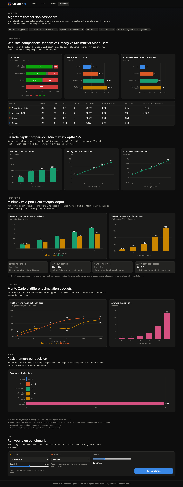
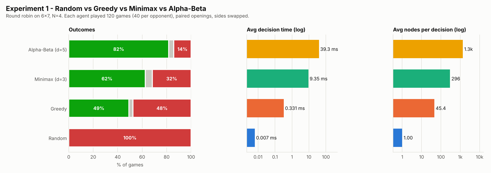
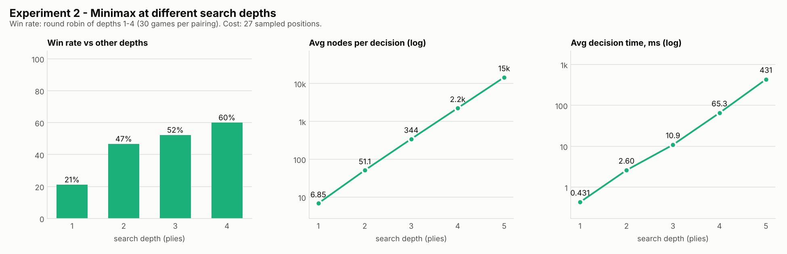
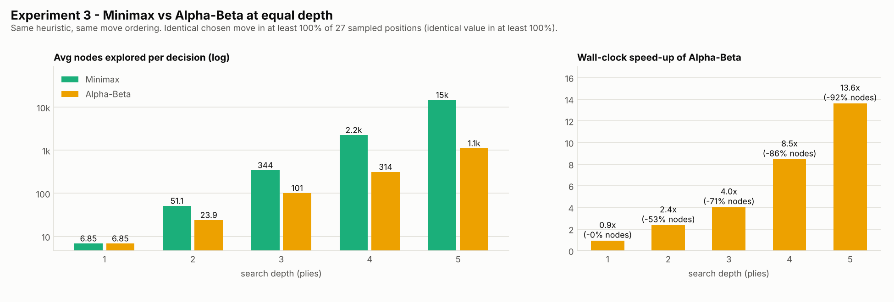
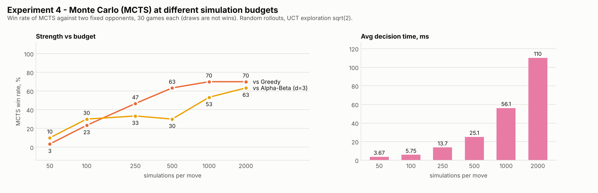
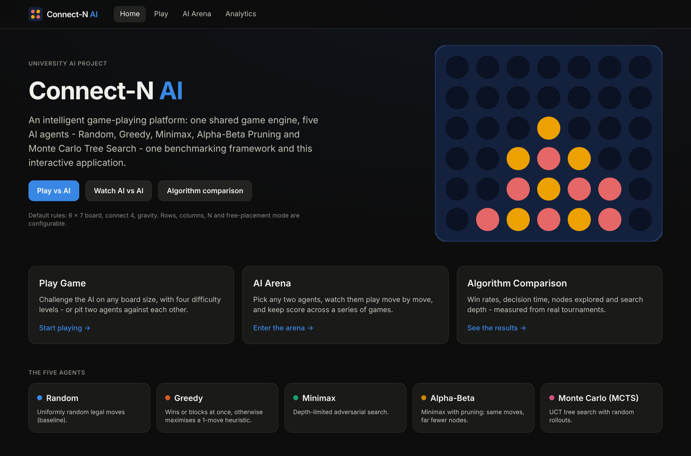
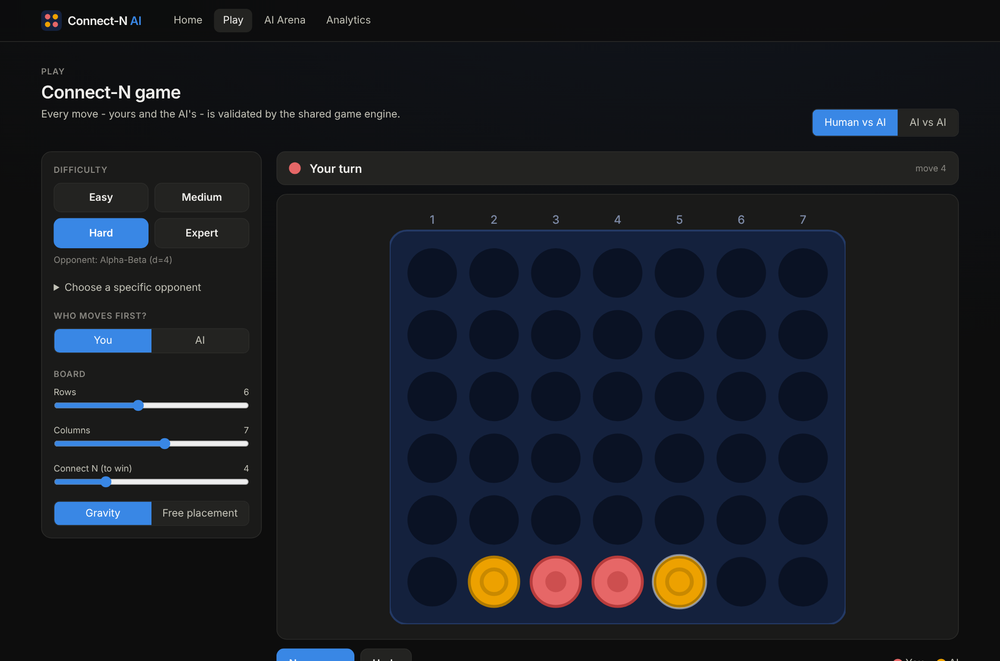
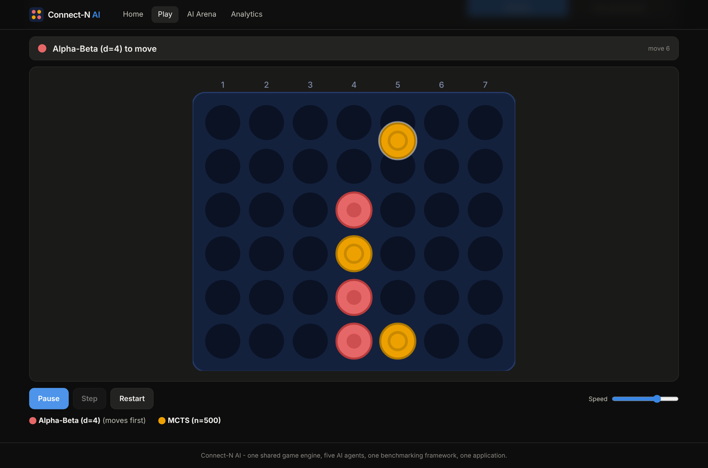
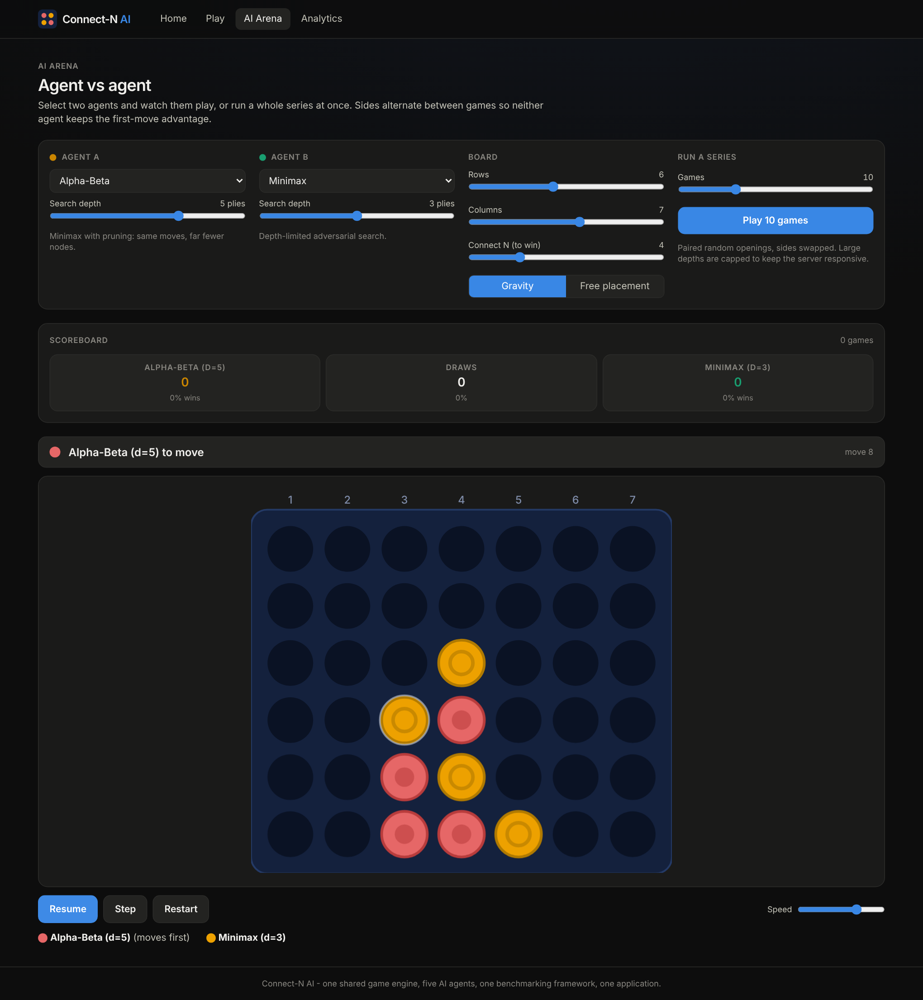
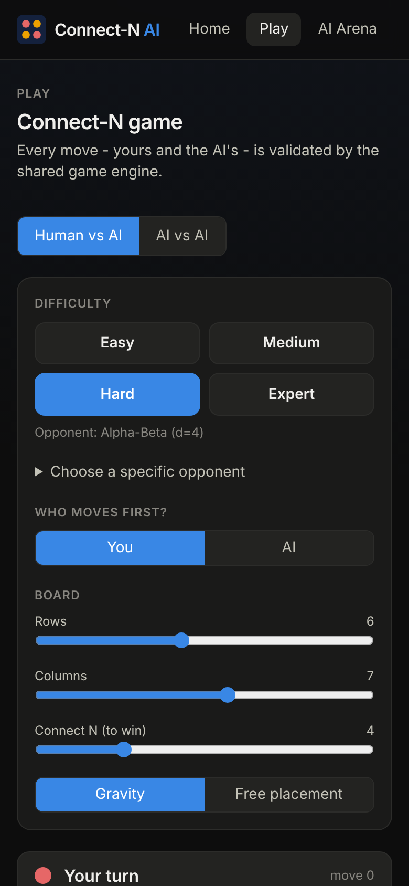

# Connect-N AI

An intelligent Connect-N game-playing platform featuring Minimax, Alpha-Beta Pruning, heuristic AI agents, Monte Carlo simulation, AI tournaments and algorithm benchmarking.

**One shared game engine + five AI agents + one benchmarking framework + one interactive application.**



## Contents

1. [Features](#features)
2. [Quick start](#quick-start)
3. [Project structure](#project-structure)
4. [Architecture](#architecture)
5. [Algorithms](#algorithms)
6. [Testing](#testing)
7. [Benchmark results](#benchmark-results)
8. [Screenshots](#screenshots)
9. [Limitations and honest notes](#limitations-and-honest-notes)

## Features

- **Configurable engine** - gravity (classic) or free-placement rules, boards up to 12x12, any N that fits (2 to the longer side), horizontal / vertical / both diagonal win detection, validated moves, draw detection, undo. Default 6 x 7, N = 4, gravity. The engine contains no AI code.
- **Five agents behind one interface** - Random, Greedy, Minimax, Alpha-Beta Pruning, Monte Carlo Tree Search.
- **Reusable heuristic** - open-window counting, immediate-threat / block terms and centre preference, with configurable weights; terminal wins and losses always override it.
- **Web app** - Home, Play (Human vs AI with four difficulty levels, or AI vs AI), AI Arena (watch matches, run series, scoreboard), Analytics dashboard.
- **Benchmarking framework** - paired-opening, side-swapped tournaments measuring win / loss / draw rate, decision time, nodes, search depth and memory; four experiments with charts and CSVs generated from executed games.
- **162 automated tests** covering the engine, heuristic, every agent, Minimax correctness, Alpha-Beta equivalence, tournaments and the HTTP API.

## Quick start

Requirements: Python 3.10+ (developed on 3.13) and Node 18+ (developed on 22).

```bash
# 1. backend
python -m venv .venv && source .venv/bin/activate      # Windows: .venv\Scripts\activate
pip install -r requirements.txt

# 2. frontend (build once)
cd frontend && npm install && npm run build && cd ..

# 3. run everything: API + UI on http://127.0.0.1:8000
uvicorn backend.api.main:app --port 8000
```

Open <http://127.0.0.1:8000>. The FastAPI server serves the built React app and the API (interactive docs at `/docs`).

**Development mode** (hot reload): run `uvicorn backend.api.main:app --reload --port 8000` and, in a second terminal, `cd frontend && npm run dev`, then open <http://localhost:5173> (Vite proxies `/api` to port 8000).

### Re-running the experiments

```bash
python -m backend.benchmarks.run_experiments            # full run, ~3.5 minutes on 2 cores
python -m backend.benchmarks.run_experiments --quick    # smoke run, ~30 seconds
python -m backend.benchmarks.report                     # regenerate docs/benchmarks.md + the README tables
```

Results are written to `docs/results/` (`benchmarks.json`, CSV tables, PNG charts); the Analytics page reads `benchmarks.json`.

## Project structure

```text
connect-n-ai/
├── backend/
│   ├── engine/        config.py, geometry.py (cached windows), game.py (rules, undo, win/draw)
│   ├── evaluation/    heuristic.py (vectorised NumPy evaluator + explainable breakdown)
│   ├── agents/        base.py (interface), random / greedy / minimax / alphabeta / mcts, factory.py
│   ├── benchmarks/    tournament.py, run_experiments.py, charts.py, report.py
│   ├── api/           main.py (FastAPI), schemas.py
│   └── tests/         162 pytest tests
├── frontend/src/
│   ├── components/    Board, LiveMatch, ui kit
│   ├── pages/         Home, Game, Arena, Analytics
│   ├── hooks/         useGame (state backed by the stateless API)
│   └── services/      api.js, agents.js
├── docs/              architecture.md, algorithms.md, benchmarks.md, results/, screenshots/
├── scripts/           capture_screenshots.py (headless-browser smoke test)
├── requirements.txt
└── README.md
```

## Architecture

```text
 React UI  ──HTTP/JSON──►  FastAPI (stateless)  ──►  Agents ──► Heuristic evaluator
 (pages, board,              replays the move list        │             │
  charts)                    through the engine           ▼             ▼
                                                      Game engine (single source of truth for the rules)
                                                              ▲
                                       Benchmark framework ───┘  (same engine, same agents)
```

- **The engine is the only code that knows the rules.** `ConnectNGame.play()` validates every move (type, range, full column / occupied cell, game over) before touching the board, and `undo()` restores the exact previous state, so search never copies boards.
- **Agents share one interface.** `Agent.select_move(game)` works on a *copy* of the game, times the decision, verifies the returned move is legal and returns a `Decision` (move, time, nodes, depth, per-move values, explanation).
- **The API keeps no sessions.** Each request carries the configuration and move list; the engine replays and validates it. A client therefore cannot reach an illegal position. Search depth is capped automatically on huge boards so a request cannot hang the server.
- **The benchmark framework reuses the same engine and agents.** Agents are rebuilt per game from seeded specs, so every experiment is reproducible.

More detail: [docs/architecture.md](docs/architecture.md).

## Algorithms

| Agent | Idea | Key parameters |
|---|---|---|
| **Random** | Uniformly random legal move; the baseline. | seed |
| **Greedy** | Win now -> block the opponent's win -> otherwise play the move whose resulting position has the best heuristic value, avoiding moves that hand the opponent an immediate win. | seed, heuristic weights |
| **Minimax** | Depth-limited adversarial search. Win at ply *p* scores `WIN - p` (sooner is better), loss `-(WIN - p)`, depth limit uses the heuristic, draw 0. | depth |
| **Alpha-Beta** | Identical search with alpha/beta bounds (fail-soft). Same heuristic, scoring and move ordering, so it picks the *same move and value* as Minimax at equal depth with far fewer nodes. Records nodes and cut-offs. | depth |
| **Monte Carlo (MCTS)** | UCT: selection (UCB1, c = sqrt 2), expansion, random rollout, back-propagation; plays the most-visited move and reports each move's estimated win probability. | simulations |

**Heuristic.** For every window of N consecutive cells: if it holds only one player's tokens (k of them) it is worth `growth^(k-1)` to that player. Own windows count positively, opponent windows negatively (x `opp_factor`). Empty cells that would complete a window *and are playable right now* add an immediate-threat bonus (own) or penalty (opponent) - the blocking incentive. A centre-closeness term rewards central tokens. All weights live in `HeuristicWeights`. Terminal states return `+-1,000,000` and heuristic values are clipped to `+-100,000`, so a heuristic score can never outrank a real win.

**Move ordering** is centre-first for all search agents, which makes alpha-beta pruning effective.

Details and pseudocode: [docs/algorithms.md](docs/algorithms.md).

## Testing

```bash
pytest                      # all 162 tests, ~5 seconds
pytest backend/tests/test_agents.py -k alpha_beta
```

| Area | What is checked |
|---|---|
| Board | initialisation, custom sizes, configuration validation |
| Moves | legal / illegal moves (out of range, full column, occupied cell, wrong type, after game over) leave the state untouched; gravity placement; free placement; undo / copy / replay |
| Winning | horizontal, vertical, both diagonals, longer-than-N lines, every direction for N = 3, 4, 5 |
| Draw | full board without a winner (gravity and free placement) |
| Tactics | immediate-win and block detection (`wins_for`), every tactical agent takes wins and blocks, wins preferred over blocks, Greedy avoids poisoned moves |
| Agents | every agent returns legal moves across 4 board configurations and many positions; never mutates the caller's game; refuses finished games |
| Minimax | values compared against an independent copy-based reference implementation; finds a forced win in 3 plies; recognises forced losses; prefers faster wins |
| Alpha-Beta | same chosen move and value as Minimax across 15 config/depth combinations and many positions, never more nodes; prunes >3x at depth 5 |
| Tournaments | complete five-agent round robin, serial == parallel, reproducible, paired openings, statistics recorded, strong agents beat Random |
| API | whole game flow, validation errors, AI moves for every difficulty, depth capping, arena series, JSON-safe scores |

The headless-browser script `scripts/capture_screenshots.py` additionally drives the running UI (plays moves, runs a match and a series, checks every page for console errors and mobile overflow) and regenerates the screenshots.

## Benchmark results

All numbers below are read from `docs/results/benchmarks.json`, which is produced by actually playing the games and running the searches (see [Re-running the experiments](#re-running-the-experiments)).

<!-- BENCH:START -->
_Measured on x86_64 with 2 CPU cores, Python 3.13.18, NumPy 2.5.3; full run took 207.3 s (generated 2026-11-13T12:38:31+00:00). Board: 6x7, connect 4, gravity. Games per pairing: 40/30/30/30 (experiments 1-4); every pair of games shares a random 4-ply opening with sides swapped._

#### Experiment 1 - Random vs Greedy vs Minimax vs Alpha-Beta (round robin)

| Agent | Games | Wins | Losses | Draws | Win rate | Avg time (ms) | Avg nodes | Depth set / reached |
|---|---|---|---|---|---|---|---|---|
| Alpha-Beta (d=5) | 120 | 98 | 17 | 5 | 81.7% | 39.3 | 1,350 | 5 / 4.9 |
| Minimax (d=3) | 120 | 75 | 38 | 7 | 62.5% | 9.35 | 296 | 3 / 3.0 |
| Greedy | 120 | 59 | 57 | 4 | 49.2% | 0.33 | 45.4 | - |
| Random | 120 | 0 | 120 | 0 | 0.0% | 0.01 | 1.00 | - |



#### Experiment 2 - Minimax at different search depths

Win rate: round robin of depths 1-4 (30 games per pairing, W-L-D in brackets). Cost: mean over 27 sampled positions.

| Depth | Win rate vs other depths | Avg nodes / decision | Avg time (ms) |
|---|---|---|---|
| 1 | 21.1% (19-63-8) | 6.85 | 0.43 |
| 2 | 46.7% (42-34-14) | 51.1 | 2.60 |
| 3 | 52.2% (47-37-6) | 344 | 10.9 |
| 4 | 60.0% (54-28-8) | 2,240 | 65.3 |
| 5 | n/a (cost only) | 14,611 | 431 |



#### Experiment 3 - Minimax vs Alpha-Beta at equal depth

| Depth | Minimax nodes | Alpha-Beta nodes | Node reduction | Minimax ms | Alpha-Beta ms | Speed-up | Same move / same value |
|---|---|---|---|---|---|---|---|
| 1 | 6.85 | 6.85 | 0.0% | 0.43 | 0.47 | 0.9x | 100% / 100% |
| 2 | 51.1 | 23.9 | 53.2% | 2.60 | 1.10 | 2.4x | 100% / 100% |
| 3 | 344 | 101 | 70.6% | 10.9 | 2.70 | 4.0x | 100% / 100% |
| 4 | 2,240 | 314 | 86.0% | 65.3 | 7.72 | 8.5x | 100% / 100% |
| 5 | 14,611 | 1,104 | 92.4% | 431 | 31.6 | 13.6x | 100% / 100% |

Head-to-head games (Minimax-AlphaBeta-draws): depth 2: 13-13-4, depth 3: 15-15-0, depth 4: 15-15-0. Because both agents make identical decisions, side-swapped game pairs split evenly - this is evidence of equivalence, not strength. Alpha-Beta alone at greater depth: depth 6: 3,158 nodes, 77.3 ms, depth 7: 11,508 nodes, 308 ms.



#### Experiment 4 - Monte Carlo at different simulation budgets

| Opponent | Simulations | MCTS W-L-D | MCTS win rate | Avg time (ms) |
|---|---|---|---|---|
| Greedy | 50 | 1-29-0 | 3% | 3.67 |
| Greedy | 100 | 7-22-1 | 23% | 5.75 |
| Greedy | 250 | 14-16-0 | 47% | 13.7 |
| Greedy | 500 | 19-9-2 | 63% | 25.1 |
| Greedy | 1000 | 21-7-2 | 70% | 56.1 |
| Greedy | 2000 | 21-8-1 | 70% | 110 |
| Alpha-Beta (d=3) | 50 | 3-27-0 | 10% | 3.03 |
| Alpha-Beta (d=3) | 100 | 9-20-1 | 30% | 5.74 |
| Alpha-Beta (d=3) | 250 | 10-20-0 | 33% | 14.3 |
| Alpha-Beta (d=3) | 500 | 9-20-1 | 30% | 27.6 |
| Alpha-Beta (d=3) | 1000 | 16-11-3 | 53% | 54.7 |
| Alpha-Beta (d=3) | 2000 | 19-11-0 | 63% | 103 |



#### Memory (peak Python-heap allocation per decision, tracemalloc)

| Agent | Avg peak (KB) | Max peak (KB) | Positions |
|---|---|---|---|
| Random | 1.5 | 1.6 | 4 |
| Greedy | 7.3 | 8.2 | 4 |
| Minimax (d=4) | 7.3 | 8.0 | 4 |
| Alpha-Beta (d=4) | 7.3 | 7.9 | 4 |
| Alpha-Beta (d=6) | 8.1 | 8.2 | 4 |
| MCTS (n=1000) | 275.9 | 280.5 | 4 |
<!-- BENCH:END -->

Full tables, CSV files and charts: [docs/benchmarks.md](docs/benchmarks.md) and [docs/results/](docs/results/).

## Screenshots

| | |
|---|---|
|  **Home** |  **Play: Human vs AI** |
|  **Play: AI vs AI** |  **AI Arena** |
|  **Responsive layout** |

## Limitations and honest notes

- **Variant.** The assignment did not fix the Connect-N variant, so gravity Connect-4 (6 x 7, N = 4) is the default and free placement is also implemented. Free-placement boards have a much larger branching factor (e.g. 42 first moves), so the API reduces search depth automatically there. On large free-placement boards N-in-a-row is trivially a first-player win, so results there are less interesting.
- **Sample sizes.** Pairings use 30-40 games (120 per agent in experiment 1). A 95 % confidence interval on a win rate is roughly +-9 percentage points at 120 games and +-18 points at 30 games, so small differences (for example MCTS 63 % vs 70 % at 500 vs 1000 simulations) are not statistically significant.
- **Equal-depth matches are 50/50 by construction.** Minimax and Alpha-Beta make identical decisions, so each side-swapped pair splits evenly; that demonstrates equivalence, not strength.
- **Timings are Python timings.** Pure Python + NumPy on a 2-core cloud machine with two worker processes; absolute times will differ on your hardware, ratios should not. Cost profiles use positions reached by random play, not strong play.
- **Memory** is the peak Python-heap allocation per decision (tracemalloc) averaged over only four sampled positions - an indication, not a profile of process memory.
- **MCTS** uses plain random rollouts without tactical shortcuts, so low budgets are weak by design; the experiment shows how strength grows with the budget.
- **Free placement + very large boards** are accepted by the API (up to 12 x 12) but only lightly exercised in the UI.

## License

Educational project; use freely with attribution.
