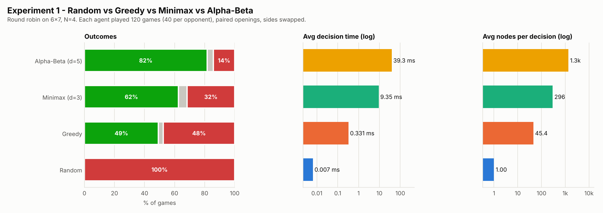
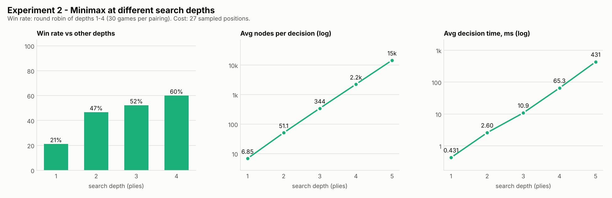
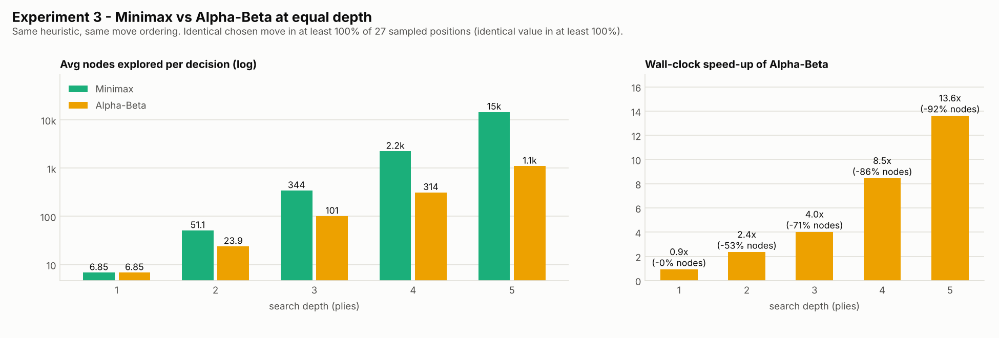
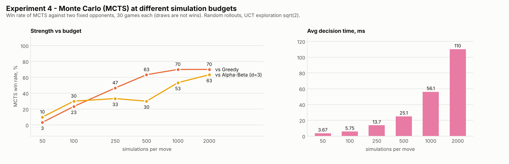

# Benchmark results

Generated by `python -m backend.benchmarks.report` from `docs/results/benchmarks.json`. Raw CSV files and charts are in `docs/results/`.

_Measured on x86_64 with 2 CPU cores, Python 3.13.18, NumPy 2.5.3; full run took 207.3 s (generated 2026-11-13T12:38:31+00:00). Board: 6x7, connect 4, gravity. Games per pairing: 40/30/30/30 (experiments 1-4); every pair of games shares a random 4-ply opening with sides swapped._

#### Experiment 1 - Random vs Greedy vs Minimax vs Alpha-Beta (round robin)

| Agent | Games | Wins | Losses | Draws | Win rate | Avg time (ms) | Avg nodes | Depth set / reached |
|---|---|---|---|---|---|---|---|---|
| Alpha-Beta (d=5) | 120 | 98 | 17 | 5 | 81.7% | 39.3 | 1,350 | 5 / 4.9 |
| Minimax (d=3) | 120 | 75 | 38 | 7 | 62.5% | 9.35 | 296 | 3 / 3.0 |
| Greedy | 120 | 59 | 57 | 4 | 49.2% | 0.33 | 45.4 | - |
| Random | 120 | 0 | 120 | 0 | 0.0% | 0.01 | 1.00 | - |

#### Experiment 2 - Minimax at different search depths

Win rate: round robin of depths 1-4 (30 games per pairing, W-L-D in brackets). Cost: mean over 27 sampled positions.

| Depth | Win rate vs other depths | Avg nodes / decision | Avg time (ms) |
|---|---|---|---|
| 1 | 21.1% (19-63-8) | 6.85 | 0.43 |
| 2 | 46.7% (42-34-14) | 51.1 | 2.60 |
| 3 | 52.2% (47-37-6) | 344 | 10.9 |
| 4 | 60.0% (54-28-8) | 2,240 | 65.3 |
| 5 | n/a (cost only) | 14,611 | 431 |

#### Experiment 3 - Minimax vs Alpha-Beta at equal depth

| Depth | Minimax nodes | Alpha-Beta nodes | Node reduction | Minimax ms | Alpha-Beta ms | Speed-up | Same move / same value |
|---|---|---|---|---|---|---|---|
| 1 | 6.85 | 6.85 | 0.0% | 0.43 | 0.47 | 0.9x | 100% / 100% |
| 2 | 51.1 | 23.9 | 53.2% | 2.60 | 1.10 | 2.4x | 100% / 100% |
| 3 | 344 | 101 | 70.6% | 10.9 | 2.70 | 4.0x | 100% / 100% |
| 4 | 2,240 | 314 | 86.0% | 65.3 | 7.72 | 8.5x | 100% / 100% |
| 5 | 14,611 | 1,104 | 92.4% | 431 | 31.6 | 13.6x | 100% / 100% |

Head-to-head games (Minimax-AlphaBeta-draws): depth 2: 13-13-4, depth 3: 15-15-0, depth 4: 15-15-0. Because both agents make identical decisions, side-swapped game pairs split evenly - this is evidence of equivalence, not strength. Alpha-Beta alone at greater depth: depth 6: 3,158 nodes, 77.3 ms, depth 7: 11,508 nodes, 308 ms.

#### Experiment 4 - Monte Carlo at different simulation budgets

| Opponent | Simulations | MCTS W-L-D | MCTS win rate | Avg time (ms) |
|---|---|---|---|---|
| Greedy | 50 | 1-29-0 | 3% | 3.67 |
| Greedy | 100 | 7-22-1 | 23% | 5.75 |
| Greedy | 250 | 14-16-0 | 47% | 13.7 |
| Greedy | 500 | 19-9-2 | 63% | 25.1 |
| Greedy | 1000 | 21-7-2 | 70% | 56.1 |
| Greedy | 2000 | 21-8-1 | 70% | 110 |
| Alpha-Beta (d=3) | 50 | 3-27-0 | 10% | 3.03 |
| Alpha-Beta (d=3) | 100 | 9-20-1 | 30% | 5.74 |
| Alpha-Beta (d=3) | 250 | 10-20-0 | 33% | 14.3 |
| Alpha-Beta (d=3) | 500 | 9-20-1 | 30% | 27.6 |
| Alpha-Beta (d=3) | 1000 | 16-11-3 | 53% | 54.7 |
| Alpha-Beta (d=3) | 2000 | 19-11-0 | 63% | 103 |

#### Memory (peak Python-heap allocation per decision, tracemalloc)

| Agent | Avg peak (KB) | Max peak (KB) | Positions |
|---|---|---|---|
| Random | 1.5 | 1.6 | 4 |
| Greedy | 7.3 | 8.2 | 4 |
| Minimax (d=4) | 7.3 | 8.0 | 4 |
| Alpha-Beta (d=4) | 7.3 | 7.9 | 4 |
| Alpha-Beta (d=6) | 8.1 | 8.2 | 4 |
| MCTS (n=1000) | 275.9 | 280.5 | 4 |
